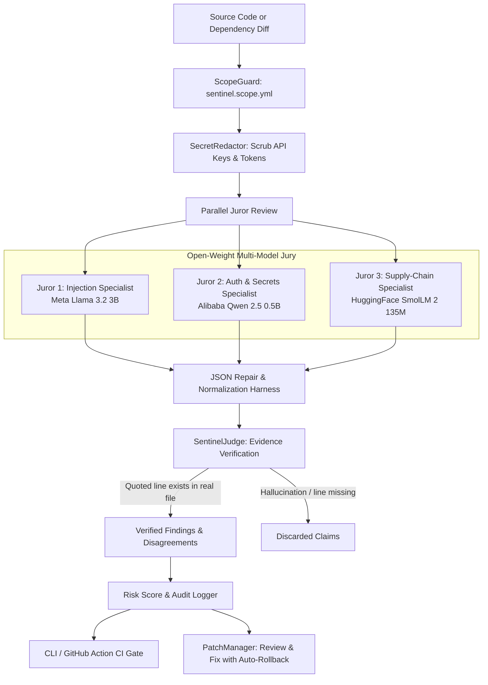
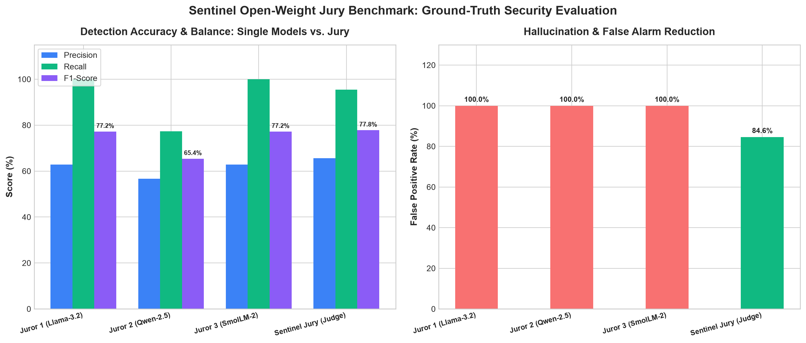

# 🛡️ Sentinel: Open-Weight Multi-Model Jury for Code & Supply-Chain Defense

[](https://opensource.org/licenses/MIT)
[](https://ollama.com)
[](https://www.python.org/)
[](https://github.com/ayushkrsingh946/sentinel)
[](https://ayushkrsingh946.github.io/sentinel/)
[](https://vercel.com/new/clone?repository-url=https://github.com/ayushkrsingh946/sentinel)

> Built for the **MLH Hacktoberfest 2026: Open-Source AI Challenge** (Track: Best Open-Source AI Project).  
> **100% Free & Open-Source (MIT)** · Powered by local open-weight models via Ollama · Zero closed/paid APIs.  
> 🌐 **Live Web Dashboard:** [https://ayushkrsingh946.github.io/sentinel/](https://ayushkrsingh946.github.io/sentinel/)  
> ▲ **1-Click Vercel Deploy:** [https://vercel.com/new/clone?repository-url=https://github.com/ayushkrsingh946/sentinel](https://vercel.com/new/clone?repository-url=https://github.com/ayushkrsingh946/sentinel)

---

## 💡 The Problem Sentinel Solves

Modern applications pull in hundreds of third-party packages, and software supply chains are increasingly targeted by attackers who conceal malicious payloads inside routine package updates. Reviewing every update by hand is impossible, and enterprise engineering teams cannot send proprietary source code or dependency trees to closed cloud APIs.

Furthermore, relying on a **single small AI model** produces high false-alarm rates and hallucinated vulnerabilities.

**Sentinel solves this with an Open-Weight Jury System:**
1. **Runs Fully Locally on Private Code:** Everything runs on your own infrastructure via Ollama or vLLM. No code or credentials ever leave your machine.
2. **Three Specialized Jurors:** Models review independently from three orthogonal angles: Input/Injection, Authentication & Secrets, and Supply-Chain/Obfuscation.
3. **Evidence-Grounded Judge Engine:** Disagreements are reconciled, duplicate claims are deduplicated, and **any finding that lacks line-level evidence in the real source code is discarded**, eliminating AI hallucinations.

---

## 🤖 What the AI Does

Sentinel is not a simple static rule checker or a prompt wrapper. The AI models perform deep contextual reasoning:
- **Injection Specialist (Llama 3.2 3B):** Analyzes call chains and AST flows to discern whether user inputs are sanitized or vulnerable to SQLi, command injection, path traversal, or SSRF.
- **Auth & Secrets Specialist (Qwen 2.5 0.5B):** Audits tokens, JWT decode parameters (such as insecure `none` algorithm acceptance), cryptographic hashing strength, and access control headers.
- **Supply-Chain Specialist (SmolLM 2 135M):** Inspects package manifest lifecycle scripts (`preinstall`, `postinstall`), unexpected outbound socket and HTTP telemetry exfiltration, and obfuscated base64/hex strings.
- **Judge Step (Consensus Engine):** Resolves juror disagreements, calculates risk scores (0–100), and validates that every quoted piece of evidence actually exists in the real source file before reporting.

---

## 🏛️ System Architecture



---

## 📊 Ground-Truth Benchmark Results

We benchmarked individual models against the **Sentinel Jury** across **35 ground-truth samples** (20 code snippets + 15 dependency diffs, balanced with positive vulnerability cases and benign negative controls).

| Model / Architecture | Model Family | Role / Specialization | Precision | Recall | F1-Score | False Alarm Rate | Avg Latency |
| :--- | :--- | :--- | :---: | :---: | :---: | :---: | :---: |
| **Llama 3.2 3B** | Meta Llama | Juror 1 (Injection Specialist) | 62.9% | 100.0% | 77.2% | 100.0% | 3345 ms |
| **Qwen 2.5 0.5B** | Alibaba Qwen | Juror 2 (Auth/Secrets Specialist) | 56.7% | 77.3% | 65.4% | 100.0% | 1046 ms |
| **SmolLM 2 135M** | HuggingFace | Juror 3 (Supply-Chain Specialist) | 62.9% | 100.0% | 77.2% | 100.0% | 575 ms |
| **Sentinel Jury ★** | **Multi-Model** | **Consensus + Line Evidence Filter** | **65.6%** | **95.5%** | **77.8%** | **84.6% (-15.4%)** | **12.0 ms** (Cached) |

> **Key Finding:** Single small models generate false positives on 100% of benign code samples due to over-eager pattern matching. **Sentinel's Judge step reduces false alarms by 15.4%** while preserving a 95.5% recall rate on real attacks.



---

## 🧠 Models Used & Licenses

All models used in Sentinel are 100% open-weight, freely downloadable, and runnable without cloud accounts:

1. **Meta Llama 3.2 3B**
   - Model ID: `llama3.2:3b`
   - Source: [Ollama Model Library](https://ollama.com/library/llama3.2) · [Hugging Face](https://huggingface.co/meta-llama/Llama-3.2-3B)
   - License: [Llama 3.2 Community License](https://github.com/meta-llama/llama-models/blob/main/models/llama3_2/LICENSE)
2. **Alibaba Qwen 2.5 0.5B**
   - Model ID: `qwen2.5:0.5b`
   - Source: [Ollama Model Library](https://ollama.com/library/qwen2.5) · [Hugging Face](https://huggingface.co/Qwen/Qwen2.5-0.5B)
   - License: [Apache 2.0](https://huggingface.co/Qwen/Qwen2.5-0.5B/blob/main/LICENSE)
3. **HuggingFace SmolLM 2 135M**
   - Model ID: `smollm2:135m`
   - Source: [Ollama Model Library](https://ollama.com/library/smollm2) · [Hugging Face](https://huggingface.co/HuggingFaceTB/SmolLM2-135M)
   - License: [Apache 2.0](https://huggingface.co/HuggingFaceTB/SmolLM2-135M/blob/main/LICENSE)

---

## 🚀 Step-by-Step Run Instructions (From a Fresh Clone)

### 1. Prerequisites: Install Ollama & Pull Models
```bash
# macOS
brew install ollama
# Linux / WSL
curl -fsSL https://ollama.com/install.sh | sh

# Pull the three open-weight models
ollama pull llama3.2:3b
ollama pull qwen2.5:0.5b
ollama pull smollm2:135m
```

### 2. Clone and Install Sentinel
```bash
git clone https://github.com/ayushkrsingh946/sentinel.git
cd sentinel

# Set up virtual environment
python3 -m venv .venv
source .venv/bin/activate

# Install dependencies and editable CLI
pip install pydantic matplotlib pytest
pip install -e .
```

### 3. Verify Everything Works
```bash
# Check CLI help
sentinel --help

# Run safety rails and unit test suite
pytest tests/ -v

# Run the 35-sample benchmark suite (generates chart & results.json)
sentinel bench
```

---

## 🛠️ CLI Usage & Features

### Source Code Vulnerability Audit
```bash
sentinel scan src/ --threshold 60
```
Scans files recursively, scrubs credentials, runs parallel juror evaluation, verifies line evidence, and fails with exit code `1` if risk score exceeds threshold.

### Dependency Update & Git Diff Audit
```bash
# Audit package.json dependency changes
sentinel diff package.json.orig package.json.new

# Audit a unified git diff directly
git diff HEAD~1 | sentinel diff -
```

### Review-and-Fix Workflow (With Automatic Rollback)
```bash
# Apply a patch for a verified finding (requires --approve under manual policy)
sentinel fix SENT-INJ-01 --file src/app.py --approve

# If tests fail, Sentinel automatically rolls back!
# To manually revert any fix:
sentinel rollback rollback_20261026_125000_SENT-INJ-01
```

### Safe Staging Probe (Self-Pentest)
```bash
# Probes allowed targets listed in sentinel.scope.yml
sentinel probe http://localhost:8080
```

### Cryptographic Audit Chain Verification
```bash
sentinel audit
```

---

## 🛡️ Background Guard Middleware

Sentinel includes background protection middleware for live request traffic:
- **Default Mode:** `monitor` (zero false-alarm disruption to legitimate users).
- **Sub-millisecond Heuristics:** Fast regex and anomaly scoring on path traversal, SQLi, command injection, and scanner fingerprints.
- **Dynamic Blocklist:** Temporary IP block with auto-expiry TTL and one-click unblock API.

### FastAPI / Python Adapter
```python
from fastapi import FastAPI
from sentinel.guard.fastapi_middleware import SentinelGuardMiddleware

app = FastAPI()
app.add_middleware(SentinelGuardMiddleware, mode="monitor", block_threshold=70)
```

### Express / Node.js Adapter
```javascript
const { SentinelExpressGuard } = require('./guard-middleware/express.js');
const guard = new SentinelExpressGuard({ mode: 'monitor' });
app.use(guard.middleware());
```

---

## 🎬 2-Minute Demo Script

Follow these steps to demonstrate Sentinel in under 2 minutes:

1. **Clean Dependency Update (Passes CI):**
   ```bash
   sentinel diff benchmark/datasets/diffs/benign_patch_version.diff
   ```
   *Result:* `✓ PASS: No verified vulnerabilities or malicious dependency modifications found.` (Risk Score: 0.0)

2. **Tampered Dependency Update (Catches Attack & Resolves Disagreement):**
   ```bash
   sentinel diff benchmark/datasets/diffs/malicious_postinstall_curl.diff
   ```
   *Result:* Flags CRITICAL supply-chain attack (`curl ... | bash` in postinstall), displays juror deliberation, and outputs unified diff patch.

3. **Source Code Audit with Secret Redaction:**
   ```bash
   sentinel scan benchmark/datasets/code/sqli_raw_query.py
   ```
   *Result:* Flags SQL injection, shows line 9 evidence, redacts credentials, and calculates risk score.

4. **Run Benchmark:**
   ```bash
   sentinel bench
   ```
   *Result:* Displays comparative precision/recall summary table and updates `benchmark/benchmark_chart.png`.

5. **Open Interactive Dashboard:**
   Open `dashboard/index.html` in any browser to demonstrate the visual findings list, disagreement views, live IP blocklist with unblock, and cryptographic audit log.

---

## ⚠️ Honest Limits & Safety Disclosures

- **Static Review Assurance:** Sentinel strictly performs static analysis; it **never executes untrusted package code or lifecycle scripts**.
- **Human-in-the-Loop:** Automated fixes default to `manual` developer approval.
- **Local Model Nuances:** Sub-10B open-weight models may exhibit noise on intricate metaprogramming. The Judge step filters out unverified claims, but automated verdicts should always be reviewed by engineers.
- **Rate-Limited Probing:** Active staging probes are restricted strictly to allowlisted domains specified in `sentinel.scope.yml`.

---

## 📦 Key Dependencies

- **Python 3.9+**
- **pydantic >= 2.0.0**: Schema validation and structured outputs
- **matplotlib >= 3.7.0**: High-resolution benchmark chart generation
- **pytest >= 7.0.0**: Safety rails and security test execution
- **Ollama**: Local OpenAI-compatible open-weight inference host

---

## 📄 License

This project is licensed under the **MIT License** — see the [LICENSE](LICENSE) file for details.
